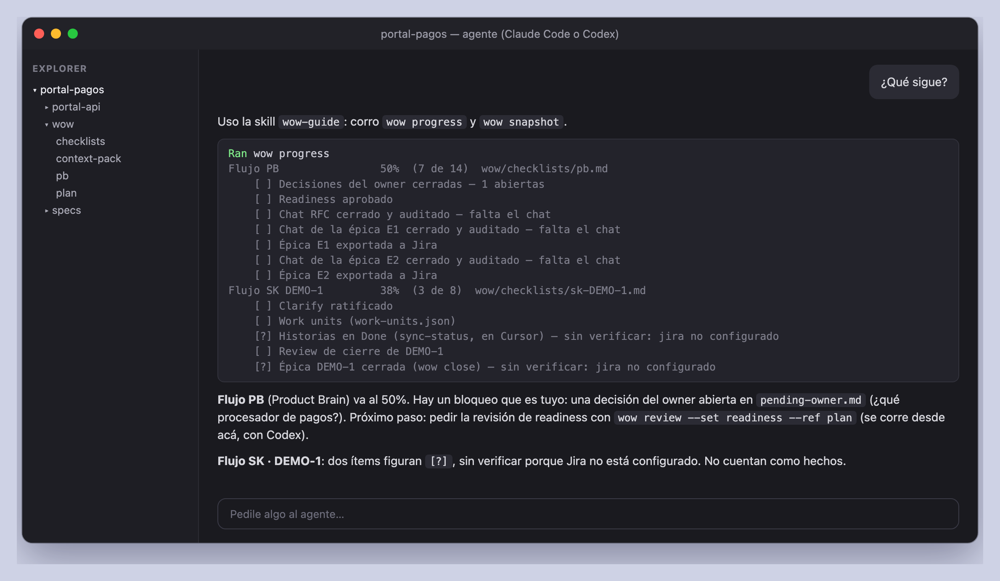

# WayOfWork

Skills atómicas y un CLI (`wow`) para trabajar con Product Brain, Spec-Kit y modelos fuertes (Claude, Codex) sin
perder la telemetría de Spec-Kit ni gastar de más el pool de Cursor. Son siete skills, y cada una responde a algo
distinto que le pedís al agente:

| Le decís al agente… | Y la skill… |
|---|---|
| *«¿Qué sigue?»*, *«¿en qué punto estoy?»* | te muestra los dos flujos (Product Brain y Spec-Kit) con su porcentaje, los bloqueos y hasta tres próximos pasos |
| *«Planeá esta iniciativa»* | arma el Brief y el kanban de épicas, tareas, criterios, estimaciones y etiquetas en `wow/plan/` |
| *«Armá el contexto desde los repos»* | escribe el context pack con cada afirmación etiquetada y con su fuente, y la hace verificar por un revisor independiente |
| *«Generá los paquetes para Product Brain»* | genera el PRD, el RFC y un paquete por épica, y comprueba en local que Product Brain los marque al 100% |
| *«Auditá el chat de Product Brain»* | compara lo que escribió Product Brain contra el paquete y el context pack, y arma las correcciones para pegarle |
| *«Preparame el paso de Spec-Kit»* | deja listos los borradores y manda el comando a Cursor, para que Cursor solo ratifique |
| *«Revisá esto con otro modelo»* | corre una revisión independiente (Codex, Copilot, Gemini, Cursor o Claude; nunca el que escribió) del plan, de una historia, de una épica o de un documento |

**La única escritura hacia Jira es `wow close --apply` (y `wow jira fix-fields --apply`), y ambos corren en seco salvo
que los pidas con `--apply`.** Todo lo demás escribe archivos locales en `wow/` y `harness/`. Las skills no se encadenan:
cada una hace un paso y vuelve a `wow-guide`. Los [límites](docs/referencia.md#revisiones-independientes) y cada comando
están en la referencia.

## Elegí por dónde empezar

| Skill | Qué resuelve | Qué toca | Se instala con | Showcase | Instalación |
|---|---|---|---|---|---|
| **`wow-guide`** | Dónde está cada flujo y qué sigue | Archivos locales (`wow/checklists/`, `wow/progress.json`); lee Jira si hay credenciales | `./install.sh --skills` | [Ver el caso](docs/showcase.md#1-saber-dónde-estás-y-qué-sigue) | [Instalar](docs/instalacion.md#1-instalar) |
| **`wow-plan`** | Pasar de una idea a un Brief y un kanban listos para revisión | Archivos locales (`wow/plan/`) | `./install.sh --skills` | [Ver el caso](docs/showcase.md#2-planificar-una-iniciativa) | [Instalar](docs/instalacion.md#1-instalar) |
| **`wow-context`** | Context pack con afirmaciones medidas y citas que existen | Archivos locales (`wow/context-pack/`); un revisor externo lee el repo | `./install.sh --skills` | [Ver el caso](docs/showcase.md#3-armar-el-context-pack) | [Instalar](docs/instalacion.md#1-instalar) |
| **`wow-pack`** | Paquetes de registro para Product Brain, verificados antes de pegarlos | Archivos locales (`wow/pb/`) | `./install.sh --skills` | [Ver el caso](docs/showcase.md#4-generar-los-paquetes-para-product-brain) | [Instalar](docs/instalacion.md#1-instalar) |
| **`wow-pb-audit`** | Auditar lo que Product Brain escribió contra el paquete | Archivos locales (`wow/pb/chats/*.audit.json`); `--deep` usa un revisor externo | `./install.sh --skills` | [Ver el caso](docs/showcase.md#5-auditar-lo-que-escribió-product-brain) | [Instalar](docs/instalacion.md#1-instalar) |
| **`wow-sk-prep`** | Preparar cada paso de Spec-Kit y mandarlo a Cursor | Borradores en `wow/sk/`; `wow sk run` maneja un `cursor-agent`; nunca manda `sync-status` | `./install.sh --skills` | [Ver el caso](docs/showcase.md#6-preparar-spec-kit-para-que-cursor-solo-ratifique) | [Instalar](docs/instalacion.md#5-spec-kit-y-cursor) |
| **`wow-review`** | Revisión independiente, anclada, con un modelo distinto al tuyo | Archivos locales (`wow/reviews/`, `harness/reviews/`) | `./install.sh --skills` | [Ver el caso](docs/showcase.md#7-una-revisión-independiente) | [Instalar](docs/instalacion.md#1-instalar) |

Además de las skills, el CLI hace tres cosas por su cuenta: [cerrar en Jira lo que Spec-Kit deja abierto](docs/showcase.md#8-cerrar-lo-que-spec-kit-deja-abierto)
(`wow close`, `wow jira fix-fields`), [medir el consumo de Cursor y frenar comandos de shell destructivos](docs/showcase.md#9-consumo-de-cursor-y-baranda-de-shell)
(`wow hook`, `wow usage`) y [armar un tablero que abre sin red](docs/showcase.md#10-un-tablero-que-abre-sin-red) (`wow dashboard`).

Para medir a los revisores, `wow eval run evals/review-basics.json [--reviewer codex]` corre un dataset de casos con
defectos plantados contra un revisor real y dice, por caso, si pasó, si falló o si no se pudo correr; un caso que no
se pudo correr nunca cuenta como pasado. Se corre a mano (llama a un modelo) y el resultado queda en `harness/evals/`.

## Un ejemplo: ¿qué sigue?

El agente corre `wow progress`, te muestra cada flujo con su porcentaje y lo que falta, y te dice qué bloqueos son tuyos
antes de proponer el próximo paso. El recorrido completo está en el [showcase](docs/showcase.md#1-saber-dónde-estás-y-qué-sigue).



## Qué documento leer

| Si querés… | Leé | Qué encontrás |
|---|---|---|
| **Instalarlo y probarlo, hablándole al agente** | [Instalación y primer uso](docs/instalacion.md) | Todo con prompts: instalar, hooks de Cursor, credenciales de Jira, tu primera consulta de estado, Spec-Kit y actualizar, con maquetas de la sesión |
| **Instalarlo comando por comando** | [Instalación detallada](docs/instalacion-detallada.md) | Requisitos, `./install.sh`, credenciales, y el recorrido corriendo cada comando de `wow`, con capturas de la terminal |
| **Ver todo lo que hace** | [Showcase](docs/showcase.md) | Cada skill en un escenario: qué le decís al agente, qué comandos corre, qué ves, qué pasa si falla |
| **Verla en el taller de skills** | [Episodio del taller](https://reimagined-adventure-7zvnw5k.pages.github.io/) | El episodio que se dio en el taller de team, publicado en GitHub Pages (sitio privado: entrás con tu cuenta de la organización). El guion vive en [`workshop/`](workshop/) |
| **Consultar un comando o un flag** | [Referencia](docs/referencia.md) | El README anterior completo: todos los comandos, el dashboard, el consumo de Cursor, las estimaciones y las revisiones |

## En tres comandos

```bash
git clone git@github.com:josefigueredo/wow.git WayOfWork   # privado: pedí acceso a la org
cd WayOfWork && ./install.sh --skills     # el CLI en ~/.local/bin/wow y las 7 skills para Claude Code y Codex
wow hook install-cursor                   # una vez por máquina: tokens de cada turno de Cursor y baranda de shell
```

Después, `wow --version` comprueba que el CLI está en el PATH (si falla, agregá `~/.local/bin`).

### Requisitos

| Qué | Para qué | Si falta |
|---|---|---|
| Python 3.9+ y git | todo `wow`; no instala dependencias | no corre |
| Spec-Kit (`uv tool install git+ssh://git@github.com/josefigueredo/spec-kit.git`) y Cursor | fases 4 a 6 | la guía se queda en la fase 3 |
| Skill `run-in-cursor`, `cursor-agent` y tmux | `wow sk run` | `wow sk run` sale con 2 y dice que no encuentra `run-in-cursor` |
| Un CLI revisor logueado (Codex, Copilot, Gemini, `cursor-agent` o Claude) distinto del que escribe | revisor independiente de `wow review` y `wow pbchat audit --deep` | `wow review` sale con 2 (no pude evaluar) |
| `gh` logueado | links a PRs en el snapshot y el dashboard | el snapshot marca GitHub como no disponible |
| Token de Jira **sin scopes** (variables `JIRA_*`) | estado de las épicas y `wow close` | Jira figura como no configurado |

El paso a paso de las credenciales está en la [instalación detallada](docs/instalacion-detallada.md#3-credenciales-de-jira).

## Desarrollo

```bash
python3 -m unittest discover -s tests          # la suite completa, incluida la de los links de la documentación
/usr/bin/python3 -m unittest discover -s tests # verifica compatibilidad con 3.9
```

Las imágenes de `docs/img/` tienen su fuente en `docs/img/src/*.html`. Las instrucciones para agentes están en
[`AGENTS.md`](AGENTS.md).
