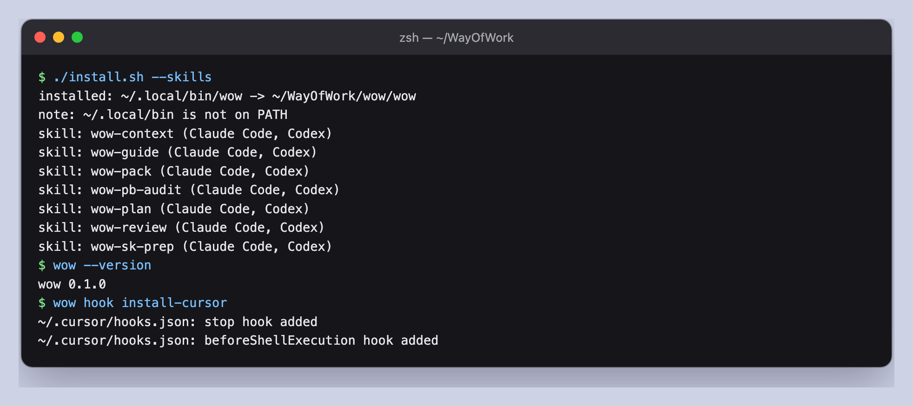
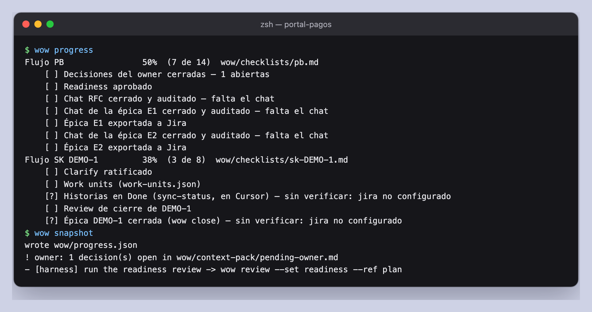
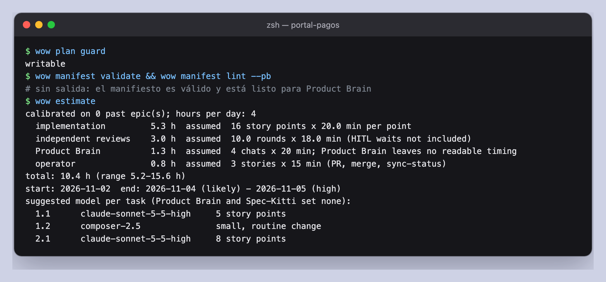
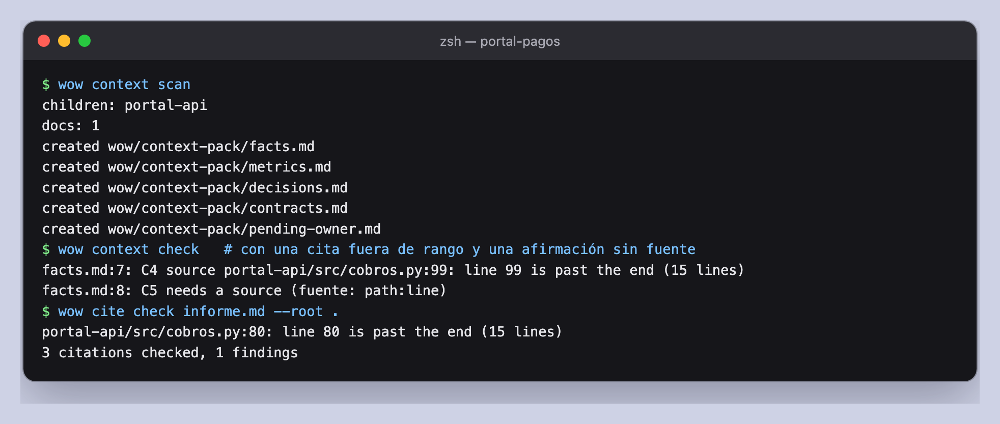
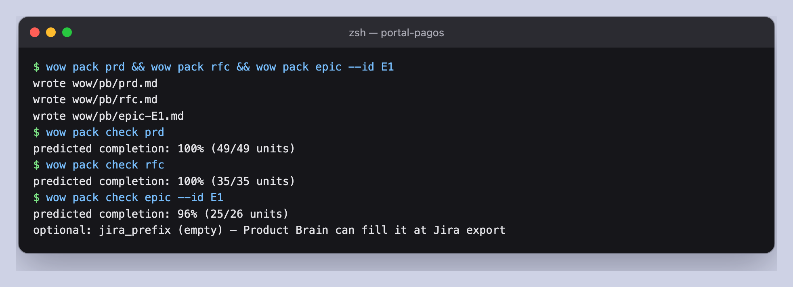
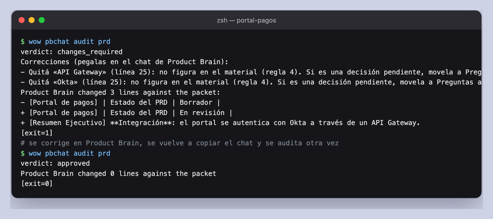
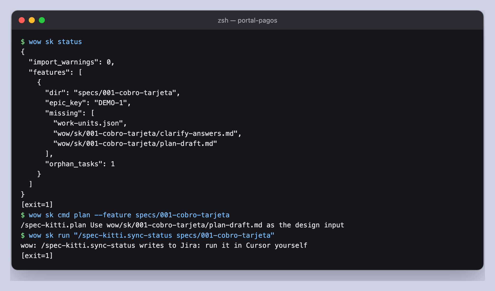
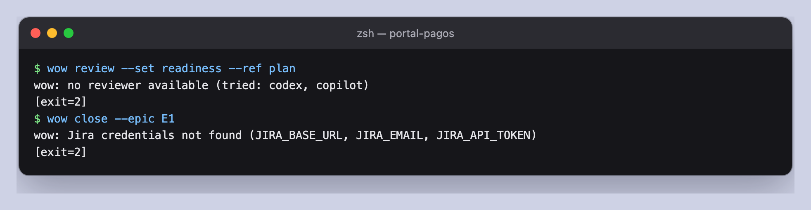

# Instalación detallada

> **¿Preferís no tocar la terminal?** La [instalación y primer uso](instalacion.md) hace lo mismo hablándole al agente.
> Esta guía es la versión comando por comando: requisitos, instalación, credenciales y un primer recorrido corriendo cada
> comando de `wow` en un proyecto de prueba (`DEMO`).

| Paso | Qué hacés |
|---|---|
| [1. Requisitos](#1-requisitos) | Qué tiene que haber en la máquina |
| [2. Instalar](#2-instalar) | Clonar y correr `./install.sh --skills` |
| [3. Credenciales de Jira](#3-credenciales-de-jira) | Token sin alcance y tres variables |
| [4. Hooks de Cursor](#4-hooks-de-cursor) | `wow hook install-cursor`, una vez por máquina |
| [5. Primer recorrido](#5-primer-recorrido) | Los comandos de cada skill, sobre un proyecto de prueba |
| [6. Mantenerlo al día](#6-mantenerlo-al-día) | `git pull` |

> **Sobre las capturas.** Son terminales dibujadas a partir de **corridas reales**, sin red y sin credenciales, sobre un
> proyecto de prueba, con las rutas acortadas (`~`). Lo que necesita Jira, Product Brain, Codex o Cursor no tiene captura:
> se explica con texto. [Origen de cada imagen](#de-dónde-sale-cada-captura).

---

## 1. Requisitos

| Qué | Para qué | Si falta |
|---|---|---|
| Python 3.9+ y git | todo `wow`; no instala dependencias | no corre |
| Spec-Kit y Cursor | fases 4 a 6 | la guía se queda en la fase 3 |
| Skill `run-in-cursor`, `cursor-agent` y tmux | `wow sk run` | `wow sk run` sale con 2 y dice que no encuentra `run-in-cursor` |
| CLI de Codex (o Copilot) logueado | `wow review` y `wow pbchat audit --deep` | `wow review` sale con 2 (no pude evaluar) |
| `gh` logueado | links a PRs en el snapshot y el dashboard | el snapshot marca GitHub como no disponible |
| Token de Jira sin alcance | estado de las épicas y `wow close` | Jira figura como no configurado |

Spec-Kit se instala con `uv tool install git+ssh://git@github.com/josefigueredo/spec-kit.git`. El repo de
WayOfWork es privado: hace falta acceso por SSH a `josefigueredo`.

## 2. Instalar

```bash
git clone git@github.com:josefigueredo/wow.git WayOfWork
cd WayOfWork
./install.sh --skills     # el CLI en ~/.local/bin/wow y las 7 skills wow-* para Claude Code y Codex
wow --version             # si falla, agregá ~/.local/bin al PATH
```



*Salida real, contra un `HOME` de prueba. El aviso `is not on PATH` aparece si `~/.local/bin` no está en tu PATH.*

`install.sh` solo crea enlaces hacia el repo, así que un `git pull` actualiza CLI y skills sin reinstalar:

- `~/.agents/skills/wow-*` apunta al repo, y `~/.claude/skills/wow-*` y `~/.codex/skills/wow-*` apuntan a
  `../../.agents/skills/wow-*`. No se instala nada para Cursor.
- Re-correrlo es seguro. Nunca reemplaza un directorio real con el mismo nombre: en ese caso sale con código 1 y dice
  cuál es.
- `./install.sh --bin-dir DIR` instala el CLI en otro directorio (que tiene que estar en el PATH).

## 3. Credenciales de Jira

Sin credenciales todo funciona menos lo que lee o escribe Jira: ahí `wow` marca Jira como no configurado.

**a) Creá un token de API sin alcance** en
[id.atlassian.com → Seguridad → Tokens de API](https://id.atlassian.com/manage-profile/security/api-tokens), con
**Create API token** (no «with scopes»). Se muestra una sola vez.
[Guía oficial](https://support.atlassian.com/atlassian-account/docs/manage-api-tokens-for-your-atlassian-account/).

> Un token con alcance responde 401 contra `https://<sitio>.atlassian.net` y Jira contesta como anónimo, así que parece
> falta de permisos. La prueba que separa los dos casos es `GET /rest/api/3/myself`.

**b) Exportá tres variables** en tu `~/.zshrc`, o escribilas en un `.env.local` en la raíz del proyecto (también sirve la
sintaxis `export`):

```bash
export JIRA_BASE_URL="https://tu-empresa.atlassian.net"   # sin barra final
export JIRA_EMAIL="vos@tu-empresa.com"
export JIRA_API_TOKEN="el-token-que-copiaste"
```

`wow` busca cada variable en este orden: el shell, `.env.local` y, como último recurso, el `.spec-kit/.env`.
Opcionales: `JIRA_PROJECT_KEY` e `JIRA_EPIC_CHILD_MODE`. Nunca se
imprimen y no se commitean.

**c) Comprobalo.** Con las variables cargadas, `wow progress` deja de decir `sin verificar: jira no configurado` en los
ítems que dependen de Jira. Sin ellas, esa frase es la señal de que no llegaron:

```text
[?] Historias en Done (sync-status, en Cursor) — sin verificar: jira no configurado
```

## 4. Hooks de Cursor

```bash
wow hook install-cursor    # una vez por máquina
```

Agrega a `~/.cursor/hooks.json`, sin tocar lo que ya tengas, un hook `stop` (guarda modelo y tokens de cada turno en
`harness/cursor-turns/` del repo que tenga `wow/`) y un hook `beforeShellExecution` (la
[baranda](showcase.md#9-consumo-de-cursor-y-baranda-de-shell)). El comando imprime una línea por hook (`stop hook added` y
`beforeShellExecution hook added`) y dice `already present` en cada uno si ya estaban. Los hooks guardan la ruta del clon: si lo movés, volvé a correrlo.
`--hooks-file RUTA` apunta a otro archivo, útil para probar.

## 5. Primer recorrido

Desde la raíz de tu proyecto, que es la del repo padre de Spec-Kit. Los códigos de salida son `0` OK, `1` hallazgos y
`2` no pude evaluar. Cada bloque corresponde a una skill; el [showcase](showcase.md) cuenta el escenario completo.

### Dónde estás: `wow-guide`

```bash
wow progress     # un checklist por flujo en wow/checklists/ con su %, y lo que falta
wow snapshot     # escribe wow/progress.json y muestra bloqueos y próximos pasos
wow state        # el estado completo en JSON, sin escribir nada
```



### Planificar: `wow-plan`

```bash
wow plan init 0001-portal-de-pagos --title "Portal de pagos" --mode greenfield
wow plan guard                       # ¿se puede editar el manifiesto?
wow manifest validate
wow manifest lint --pb               # lo que Product Brain exige por historia
wow estimate                         # horas y fecha; --history <épica terminada> las calibra
```



### Contexto: `wow-context`

```bash
wow context scan                     # inventario y esqueleto de archivos
wow context check                    # cada «fuente: ruta:línea» existe y está en rango
wow cite check informe.md --root .   # lo mismo para cualquier documento que cite código entre `backticks`
```



### Paquetes: `wow-pack`

```bash
wow pack prd && wow pack rfc && wow pack epic --id E1
wow pack check prd && wow pack check rfc && wow pack check epic --id E1
```



### Auditoría: `wow-pb-audit`

Con la copia del chat en `wow/pb/chats/prd.md` y la del panel en `wow/pb/chats/prd.final.md`:

```bash
wow pbchat audit prd                 # --deep suma un revisor independiente (Codex)
wow pbchat audit prd --decide approved --reason "<por qué>"   # lo corrés vos, nunca el agente
```



*La copia del chat de esta captura es ficticia; la auditoría es real y determinista.*

### Spec-Kit: `wow-sk-prep`

```bash
wow sk status                                        # qué falta en cada feature
wow sk cmd plan --feature specs/001-cobro-tarjeta    # el comando exacto
wow sk run "/spec-kit.plan …"                      # lo manda a Cursor (necesita run-in-cursor)
wow sk start DEMO-1                                  # seguir una épica hecha fuera de Product Brain
```



### Revisión y cierre: `wow-review` y `wow close`

```bash
wow review --set readiness --ref plan    # necesita Codex o Copilot
wow close --epic E1                      # en seco; --apply escribe en Jira
```



*Salida real de una máquina **sin** Codex ni credenciales de Jira: ambos salen con 2.*

## 6. Mantenerlo al día

```bash
git -C WayOfWork pull --ff-only
```

No hace falta reinstalar. Si cambió el layout de las skills, volvé a correr `./install.sh --skills`.

---

## De dónde sale cada captura

| Imagen | Origen |
|---|---|
| `img/terminal-instalar.png` | Salida **real** de `./install.sh --skills`, `wow --version` y `wow hook install-cursor --hooks-file` contra un `HOME` de prueba |
| `img/terminal-progress.png` | **Real**: `wow progress` y `wow snapshot` sobre el proyecto `DEMO` |
| `img/terminal-plan.png` | **Real**: `wow plan guard`, `wow manifest validate`/`lint --pb` y `wow estimate` |
| `img/terminal-context.png` | **Real**: `wow context scan`/`check` y `wow cite check` sobre un repo de prueba |
| `img/terminal-pack.png` | **Real**: `wow pack` y `wow pack check` |
| `img/terminal-auditoria.png` | **Real** sobre una copia de chat **ficticia** |
| `img/terminal-sk.png` | **Real**: `wow sk status`, `wow sk cmd` y el rechazo de `sync-status` |
| `img/terminal-sin-red.png` | **Real**, sin Codex ni credenciales |

Las fuentes HTML están en [`img/src/`](img/src).
