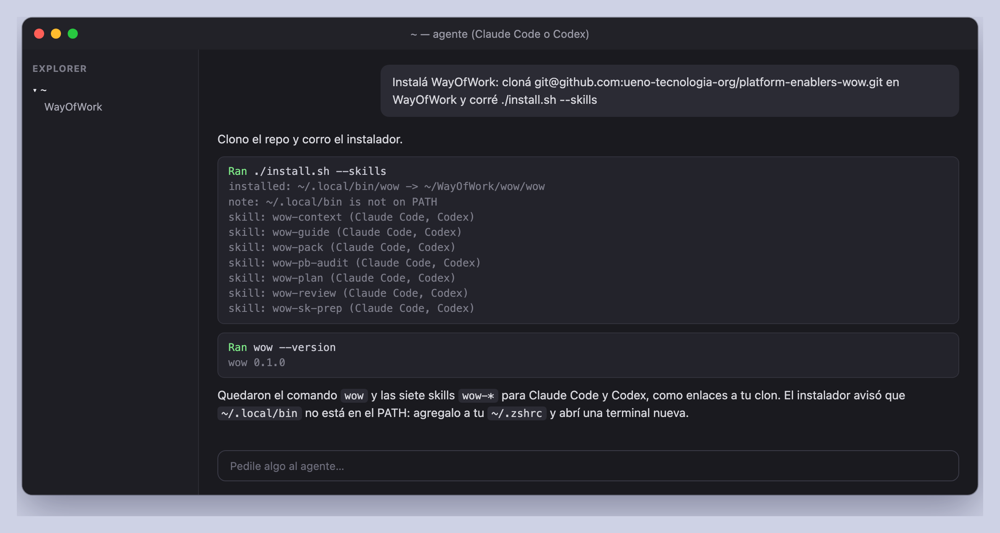
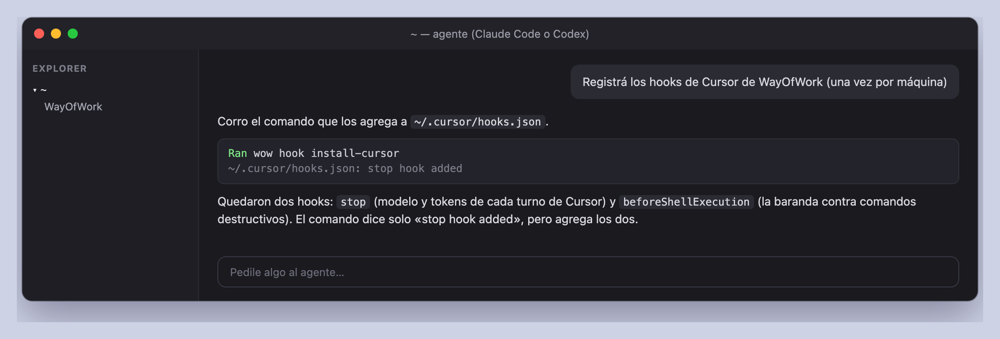
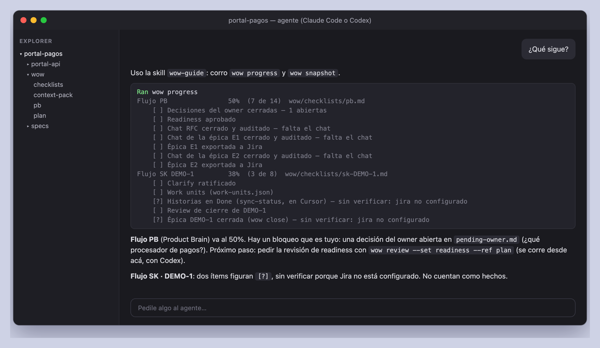
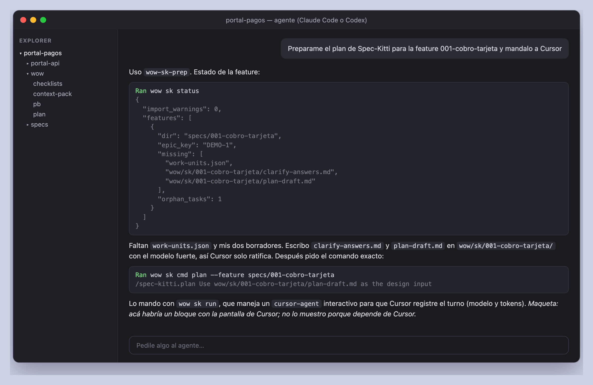
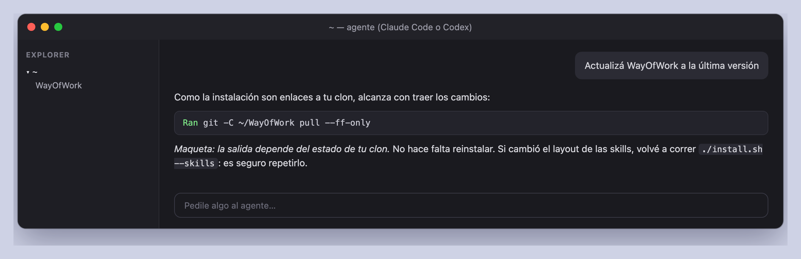

# Instalación y primer uso, hablándole al agente

Casi todo esto se hace conversando con el agente (Claude Code o Codex): le pedís las cosas y él corre `wow` por vos.
Algunos pasos **no** son un prompt, y es a propósito:

- **El token de Jira** es un secreto: lo creás y lo guardás vos, y no lo pegues en el chat.
- **Los inicios de sesión** (Codex, `gh`, Cursor, Spec-Kit) son interactivos: los hacés vos en una terminal.
- **Lo que decide una persona** no lo decide el agente: aprobar una auditoría de Product Brain
  (`wow pbchat audit … --decide`), resolver una revisión escalada a una persona (`wow review --decide`), correr
  `/spec-kit.sync-status` en Cursor, y confirmar `wow close --apply`, que es la única escritura de `wow` hacia Jira.
- **Pegar en Product Brain** (el preámbulo, el paquete, las correcciones) también lo hacés vos, en su chat.

> ¿Preferís ver (o correr) cada comando? Está la [instalación detallada](instalacion-detallada.md). Para ver todo lo que
> hace la herramienta, el [showcase](showcase.md).

| Paso | Qué hacés | Cómo |
|---|---|---|
| [1. Instalar](#1-instalar) | Dejar `wow` y las siete skills andando | Un prompt |
| [2. Hooks de Cursor](#2-hooks-de-cursor) | Medir cada turno de Cursor y activar la baranda de shell | Un prompt |
| [3. Credenciales de Jira](#3-credenciales-de-jira) | Crear un token y comprobar que `wow` lo ve | Manual + un prompt |
| [4. Tu primera consulta](#4-tu-primera-consulta) | Pedirle al agente dónde estás y qué sigue | Un prompt |
| [5. Spec-Kit y Cursor](#5-spec-kit-y-cursor) | Dejar listo lo que necesita `wow sk run` | Manual + un prompt |
| [6. Mantenerlo al día](#6-mantenerlo-al-día) | Traer la última versión | Un prompt |

> **Sobre las capturas.** Son **maquetas**: muestran cómo se ve una sesión con el agente, no una sesión grabada, y el texto
> del agente es ilustrativo. Los bloques `Ran` reproducen la salida real de esos comandos, corridos sin red y sin
> credenciales sobre un proyecto de prueba (`DEMO`), con las rutas acortadas. Lo que depende de Jira, Product Brain,
> Codex o Cursor se cuenta con texto y datos ficticios, y la maqueta lo dice.
> [Tabla con el origen de cada imagen](#de-dónde-sale-cada-captura).

---

## 1. Instalar

Necesitás `python3` 3.9 o más, `git` y acceso por SSH a `josefigueredo` (el repo es privado: pedí acceso a la org).
Abrí cualquier carpeta con el agente y pedile:

> Instalá WayOfWork: cloná git@github.com:josefigueredo/wow.git en WayOfWork y corré ./install.sh --skills



*Los bloques «Ran» son la salida real del instalador y de `wow --version` (rutas acortadas).*

Qué pasó:

- **Siete skills** quedaron disponibles en Claude Code y Codex: `wow-guide`, `wow-plan`, `wow-context`, `wow-pack`,
  `wow-pb-audit`, `wow-sk-prep` y `wow-review`. El instalador las deja para esos dos agentes, no para Cursor.
- **El comando `wow`** quedó en `~/.local/bin`. Es lo que el agente usa por detrás.
- **No se copió nada**: son enlaces a tu clon, así que hay una sola fuente de verdad. Instalar de nuevo es seguro, y si
  ya hay un directorio real con el nombre de una skill, el instalador no lo reemplaza: sale con código 1 y dice cuál es.

Si el instalador avisa `note: … is not on PATH` (como en la captura), pedile al agente que agregue `~/.local/bin` al PATH
de tu `~/.zshrc` y abrí una terminal nueva.

## 2. Hooks de Cursor

Una vez por máquina, pedile:

> Registrá los hooks de Cursor de WayOfWork



*El bloque «Ran» es la salida real (corrida contra un `hooks.json` de prueba).*

Esto agrega dos hooks a `~/.cursor/hooks.json`, junto a los que ya tengas: `stop` guarda el modelo y los tokens de cada
turno del agente de Cursor, y `beforeShellExecution` es la [baranda](showcase.md#9-consumo-de-cursor-y-baranda-de-shell)
contra comandos destructivos. El comando imprime una línea por hook (`stop hook added` y `beforeShellExecution hook added`). Los hooks apuntan a la
ruta de tu clon: si lo movés, volvé a correr el comando.

## 3. Credenciales de Jira

Esto lo hacés vos. `wow` las usa para leer el estado de las épicas y para `wow close`; sin ellas todo lo demás funciona
y Jira figura como no configurado.

**a) Creá un token de API sin alcance.** Entrá a
[id.atlassian.com → Seguridad → Tokens de API](https://id.atlassian.com/manage-profile/security/api-tokens), apretá
**Create API token** (no «with scopes»), poné un nombre y un vencimiento y copialo: se muestra una sola vez.
[Guía oficial](https://support.atlassian.com/atlassian-account/docs/manage-api-tokens-for-your-atlassian-account/).

> **Un token con alcance no sirve acá.** Contra `https://<sitio>.atlassian.net` responde 401 y Jira contesta como
> anónimo, así que parece falta de permisos. La prueba que separa los dos casos es `GET /rest/api/3/myself`.

**b) Guardá tres variables** en tu shell (`~/.zshrc`) o en un archivo `.env.local` en la raíz del proyecto, con un editor,
no por el chat. Son las variables que `wow` lee:

```bash
export JIRA_BASE_URL="https://tu-empresa.atlassian.net"   # sin barra final
export JIRA_EMAIL="vos@tu-empresa.com"
export JIRA_API_TOKEN="el-token-que-copiaste"
```

Opcionales: `JIRA_PROJECT_KEY` e `JIRA_EPIC_CHILD_MODE`. Como último recurso, `wow` lee las mismas variables del
`.spec-kit/.env` de Spec-Kit. Nunca las imprime ni las commitees.

**c) Comprobá que las ve.** Abrí una terminal nueva (para que cargue las variables) y pedile:

> Corré wow progress y decime si Jira figura como configurado

Si algún ítem sigue diciendo `sin verificar: jira no configurado`, las variables no llegaron a ese proceso.

## 4. Tu primera consulta

En la carpeta de tu proyecto, la raíz del repo padre de Spec-Kit, pedile:

> ¿Qué sigue?



*El bloque «Ran» es la salida real de `wow progress` sobre un proyecto de prueba; la explicación es ilustrativa.*

El agente usa `wow-guide`: te muestra el flujo de Product Brain y uno de Spec-Kit por épica, cada uno con su
porcentaje y lo que falta, los bloqueos (que son decisiones tuyas) y hasta tres próximos pasos con dónde correrlos. Un
ítem `[?]` no pudo verificarse (Jira caído o sin registro) y nunca cuenta como hecho. A partir de acá, cada paso tiene
su caso en el [showcase](showcase.md): planificar, armar el contexto, generar los paquetes, auditar, preparar
Spec-Kit, revisar y cerrar.

## 5. Spec-Kit y Cursor

Las fases 4 a 6 corren en Spec-Kit y Cursor. Lo que sigue lo hacés vos, en una terminal, porque son inicios de
sesión y herramientas externas:

- Instalar Spec-Kit: `uv tool install git+ssh://git@github.com/josefigueredo/spec-kit.git`. Sin él, la
  guía se queda en la fase 3.
- Iniciar sesión en Cursor y tener `cursor-agent`, y tmux, para `wow sk run`.
- Tener la skill `run-in-cursor` (otro repo del Harness): `wow sk run` la usa para manejar un `cursor-agent` interactivo.
  Sin ella sale con código 2 y dice `run-in-cursor/ric.py not found`.
- Iniciar sesión en Codex (o Copilot) para las revisiones independientes, y en `gh` para los links a PRs.

Cuando esté, pedile:

> Preparame el plan de Spec-Kit de la feature 001-cobro-tarjeta y mandalo a Cursor



*El bloque «Ran» de `wow sk status` y el de `wow sk cmd` son salida real; lo que pasa en Cursor es ilustrativo.*

El agente nunca manda `/spec-kit.sync-status` (escribe en Jira): ese lo corrés vos en Cursor.

## 6. Mantenerlo al día

Como `install.sh` solo crea enlaces hacia tu clon, un `git pull` actualiza el CLI y las skills. Pedile:

> Actualizá WayOfWork a la última versión



*Maqueta: el bloque «Ran» va sin salida porque depende del estado de tu clon.*

---

## Si algo falla

| Qué ves | Por qué | Qué hacer |
|---|---|---|
| `wow: command not found` | `~/.local/bin` no está en el PATH | Agregalo a tu `~/.zshrc` y abrí una terminal nueva |
| `refusing to replace …: it is not a symlink` y código 1 | Ya hay un directorio real con el nombre de una skill | Movelo a otro lado y volvé a correr `./install.sh --skills`; el instalador no lo borra |
| Jira figura `sin verificar: jira no configurado` | Las variables `JIRA_*` no llegaron al proceso | Revisá el [paso 3](#3-credenciales-de-jira) y abrí una terminal nueva |
| Jira responde como anónimo o da 401 | El token se creó con alcance | Creá uno nuevo con **Create API token** a secas |
| `wow review` sale con 2: `no reviewer available` | No hay Codex ni Copilot en el PATH, o no pasaron la prueba | Instalá y logueá uno de los dos |
| `wow sk run` sale con 2: `ric.py not found` | Falta la skill `run-in-cursor` | Instalala (su `install.sh`) o apuntá `WOW_RIC` a su `ric.py` |
| `wow sk run` sale con 1: `writes to Jira` | Pediste `/spec-kit.sync-status` | Correlo vos en Cursor |
| La baranda de shell no actúa | Falta el hook, o el clon cambió de lugar | Volvé a correr el [paso 2](#2-hooks-de-cursor) |

## De dónde sale cada captura

| Imagen | Qué es | Origen |
|---|---|---|
| `img/cursor-instalar.png` | Maqueta de sesión | Texto del agente ilustrativo; los bloques `Ran` son salida **real** de `./install.sh --skills` y `wow --version` contra un `HOME` de prueba |
| `img/cursor-hook.png` | Maqueta de sesión | Texto ilustrativo; el bloque `Ran` es salida **real** de `wow hook install-cursor --hooks-file` sobre un archivo de prueba |
| `img/cursor-guia.png` | Maqueta de sesión | Texto ilustrativo; el bloque `Ran` es salida **real** de `wow progress` sobre el proyecto de prueba |
| `img/cursor-sk.png` | Maqueta de sesión | Texto ilustrativo; los bloques `Ran` de `wow sk status` y `wow sk cmd` son salida **real**; el envío a Cursor no se muestra |
| `img/cursor-actualizar.png` | Maqueta de sesión | Todo ilustrativo; no hay salida |

Las fuentes HTML de cada imagen están en [`img/src/`](img/src).
