# Showcase

Qué se puede hacer con WayOfWork, escenario por escenario: qué le decís al agente, qué comandos corre por detrás y qué
ves en pantalla. Para instalarlo, la [guía con prompts](instalacion.md) o la [detallada](instalacion-detallada.md); para
cada comando y flag, la [referencia](referencia.md).

| Skill | Escenario | Ir al caso |
|---|---|---|
| `wow-guide` | «¿Qué sigue?», «¿en qué punto estoy?» | [Dónde estás](#1-saber-dónde-estás-y-qué-sigue) |
| `wow-plan` | «Planeá esta iniciativa» | [Planificar](#2-planificar-una-iniciativa) |
| `wow-context` | «Armá el contexto desde los repos» | [Context pack](#3-armar-el-context-pack) |
| `wow-pack` | «Generá los paquetes para Product Brain» | [Paquetes](#4-generar-los-paquetes-para-product-brain) |
| `wow-pb-audit` | «Auditá el chat de Product Brain» | [Auditoría](#5-auditar-lo-que-escribió-product-brain) |
| `wow-sk-prep` | «Preparame el paso de Spec-Kit» | [Spec-Kit](#6-preparar-spec-kit-para-que-cursor-solo-ratifique) |
| `wow-review` | «Revisá esto con otro modelo» | [Revisión](#7-una-revisión-independiente) |
| *(CLI)* `wow close`, `wow jira fix-fields` | Cerrar en Jira lo que Spec-Kit deja abierto | [Cierre](#8-cerrar-lo-que-spec-kit-deja-abierto) |
| *(CLI)* `wow hook`, `wow usage` | Consumo de Cursor y baranda de shell | [Hooks](#9-consumo-de-cursor-y-baranda-de-shell) |
| *(CLI)* `wow dashboard` | Un tablero que abre sin red | [Tablero](#10-un-tablero-que-abre-sin-red) |

> **Sobre las salidas.** Todos los casos usan un proyecto de prueba, **«Portal de pagos»**, con épicas, repo y claves
> ficticios (`DEMO-1`, `Ana Gómez`). Las capturas de terminal y los bloques `Ran` son **salida real** de `wow`, corrida
> sin red ni credenciales. Lo que necesita Jira, Product Brain, Codex o Cursor no tiene salida: se cuenta con texto y lo
> dice. Las conversaciones con el agente son **maquetas**.

---

## Lo que lo distingue

| | |
|---|---|
| **Dos flujos, una sola clave** | Product Brain (contexto, plan, paquetes, chats, export) y Spec-Kit (uno por épica) solo se tocan en la clave de la épica de Jira |
| **Medir, no especular** | Todo valor medible se mide antes de afirmarlo y se cita; lo que no, se rotula como inferencia. `wow context check`, `wow cite check` y `wow ref check` lo comprueban sin un modelo de por medio |
| **Revisor distinto del autor** | El modelo que escribe el plan no lo revisa: `wow review` usa Codex (o Copilot) y tiene un tope de tres rondas antes de pasar a una persona |
| **Las personas deciden** | Aprobar una auditoría (`--decide`), resolver una revisión escalada y correr `sync-status` son de una persona; `wow` los registra pero no los toma por vos |
| **Evidencia, no tildes** | `wow progress` deriva cada ítem de archivos, revisiones y Jira; un ítem sin verificar es `[?]` y nunca cuenta como hecho |
| **Una sola escritura hacia Jira** | `wow close --apply` (y `wow jira fix-fields --apply`), siempre en seco por defecto y con un registro en `harness/jira-writes.jsonl` |

---

## 1. Saber dónde estás y qué sigue

**Skill:** `wow-guide` · **Toca:** archivos locales (`wow/checklists/`, `wow/progress.json`).

Abrís una sesión de trabajo o terminaste un paso y no sabés qué toca.

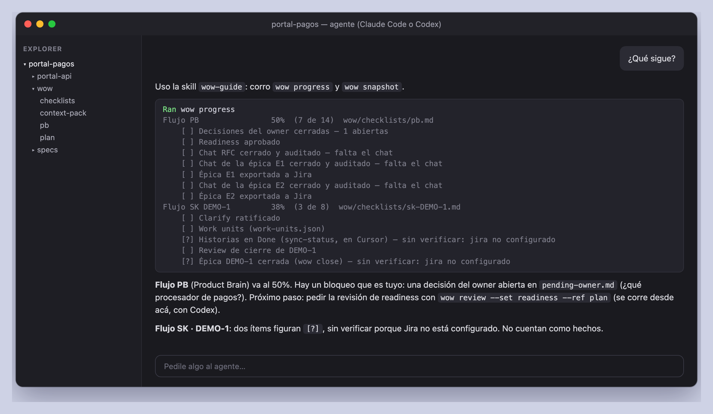

*Maqueta de la conversación; el bloque «Ran» es salida real.*

### Qué corre el agente

| # | Comando | Para qué | ¿Escribe? |
|---|---|---|---|
| 1 | `wow progress` | Un checklist por flujo con su porcentaje y lo que falta | Solo `wow/checklists/` |
| 2 | `wow snapshot` | Bloqueos y próximos pasos; escribe `wow/progress.json` | Solo local |
| 3 | `wow state` | El estado completo en JSON, sin escribir nada | No |

### Lo que ves en la terminal

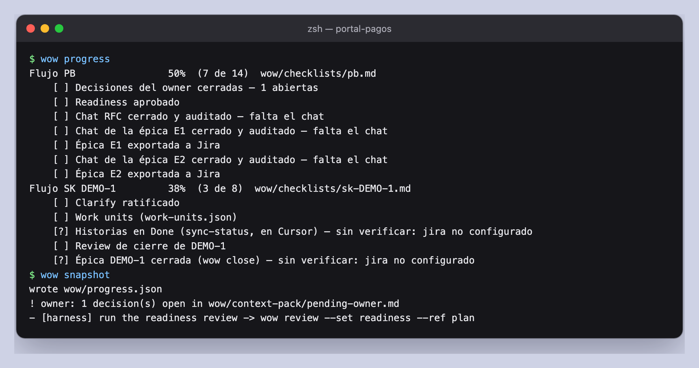

Dos flujos: **PB** (Product Brain) y **SK · DEMO-1** (Spec-Kit, uno por épica). Los dos ítems `[?]` del flujo SK no
pudieron verificarse porque no hay credenciales de Jira, y por eso no cuentan como hechos. El bloqueo que `snapshot`
marca con `!` es una decisión del owner: lo resuelve una persona, no se infiere.

**Qué pasa si algo sale mal**

| Situación | Resultado |
|---|---|
| `.wow/config.json` no es JSON válido | Sale con código 2 y dice el error; el agente lo informa y no adivina |
| Jira no responde o no está configurado | Los ítems que dependen de Jira quedan `[?]`, nunca `[x]` |
| Un ítem manual se tildó sin `— evidencia: …` | No cuenta, y `wow progress` lo avisa |

Para una épica hecha fuera de Product Brain (por ejemplo con `jtk`), `wow sk start KEY` la suma al flujo SK.

---

## 2. Planificar una iniciativa

**Skill:** `wow-plan` · **Toca:** archivos locales (`wow/plan/`).

Querés pasar de una idea a un Brief y un kanban de épicas, tareas con criterios y estimaciones.

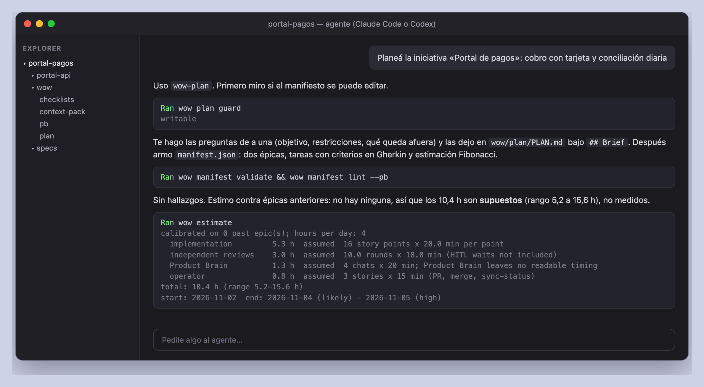

*Maqueta; los bloques «Ran» de `wow plan guard` y `wow estimate` son salida real.*

### Qué corre el agente

| # | Comando | Para qué | ¿Escribe? |
|---|---|---|---|
| 1 | `wow plan guard` | ¿Se puede editar el manifiesto? (`writable`, o está congelado) | No |
| 2 | `wow plan init 0001-… --title "…" --mode greenfield` | Crear el manifiesto si no existe | Local |
| 3 | *(edita `PLAN.md` y `manifest.json`)* | Brief, épicas, tareas con Gherkin, estimación Fibonacci | Local |
| 4 | `wow manifest validate`, `wow manifest lint`, `wow manifest lint --pb` | Validar el esquema y lo que Product Brain exige | No |
| 5 | `wow estimate` | Horas y fecha, y qué modelo de Cursor conviene por tarea | No |

### Lo que ves en la terminal

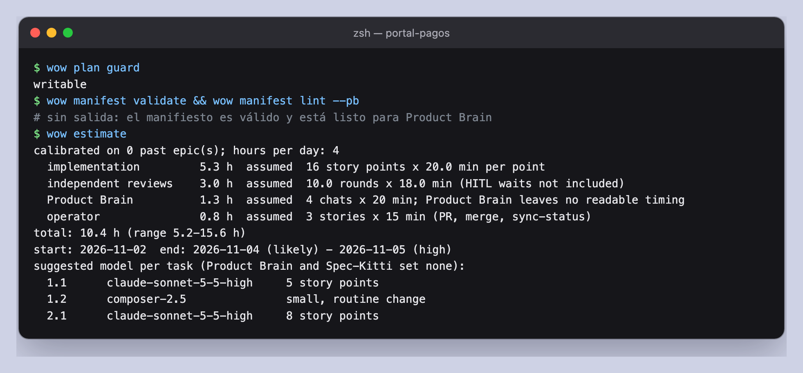

`wow estimate` dice, componente por componente, si el número es **medido** o **supuesto**. Sin épicas anteriores todo es
supuesto: con `--history <proyecto de una épica terminada>` se calibra con lo medido.

Cuando algo falta, `lint --pb` lo dice antes de que llegue a Product Brain y sale con 1:

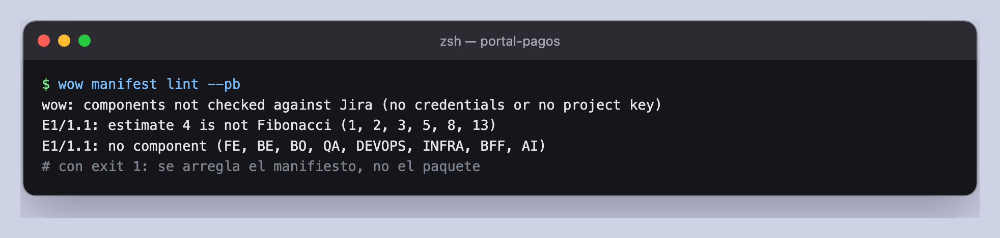

*El aviso `components not checked against Jira` aparece porque esta corrida no tenía credenciales.*

**Qué pasa si algo sale mal**

| Situación | Resultado |
|---|---|
| El manifiesto está congelado (`plan guard` sale con 1) | El agente se detiene y explica el camino de cambio de alcance; no edita |
| No hay manifiesto (sale con 2) | Se crea con `wow plan init` |
| Un criterio de aceptación no es verificable | La revisión de readiness lo marca (R1) |

La revisión de readiness (`wow review --set readiness --ref plan`) la hace otro modelo: ver el [caso 7](#7-una-revisión-independiente).

---

## 3. Armar el context pack

**Skill:** `wow-context` · **Toca:** archivos locales (`wow/context-pack/`); el revisor externo lee el repo.

Antes de planificar con datos, necesitás hechos, métricas, decisiones y contratos que se puedan rastrear al código.

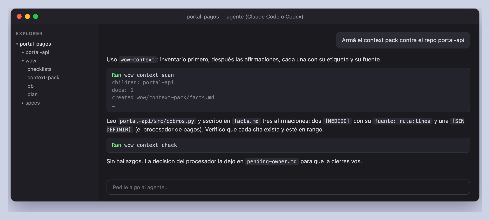

*Maqueta; los bloques «Ran» son reales (el primero, abreviado).*

### Qué corre el agente

| # | Comando | Para qué | ¿Escribe? |
|---|---|---|---|
| 1 | `wow context scan` | Inventario de repos y documentos; crea los archivos que falten | Local |
| 2 | *(escribe `- C1: … [MEDIDO] (fuente: ruta:línea)`)* | Cada afirmación con su etiqueta y su fuente | Local |
| 3 | `wow context check` | Cada fuente existe y está en rango | No |
| 4 | `wow cite check informe.md --root .` | Lo mismo para cualquier documento que cite código | No |
| 5 | `wow review --set claims --ref facts --doc … --repo …` | Un revisor independiente verifica los hechos | Ver [caso 7](#7-una-revisión-independiente) |

### Lo que ves en la terminal

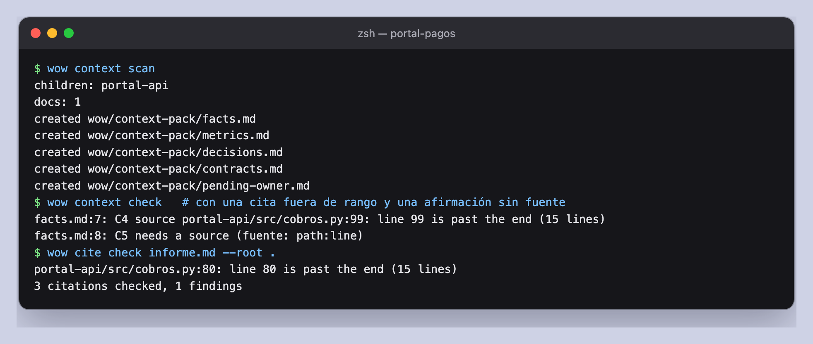

`wow context check` sale con 1 por dos cosas: la fuente `portal-api/src/cobros.py:99` apunta más allá del final del archivo
(que tiene 15 líneas), y `C5` no trae fuente. `wow cite check` hace lo mismo para un informe: solo mira lo que está
entre `` `backticks` `` con la forma `ruta:línea`. Es determinista: no depende de un modelo.

**Qué pasa si algo sale mal**

| Situación | Resultado |
|---|---|
| Una afirmación sin fuente | O queda como `[SIN DEFINIR]` o se quita |
| Spec-Kit pisó el discovery verificado | `wow context check` falla y `wow context restore` lo repone |
| La documentación vive en un repo y el código en hermanos | La raíz del proyecto tiene que ser la carpeta que los contiene (ver la [limitación conocida](referencia.md#limitación-conocida-workspaces-de-varios-repos)) |

---

## 4. Generar los paquetes para Product Brain

**Skill:** `wow-pack` · **Toca:** archivos locales (`wow/pb/`).

Product Brain registra el trabajo; no lo planifica. Los paquetes llevan el plan en la forma exacta de su plantilla.

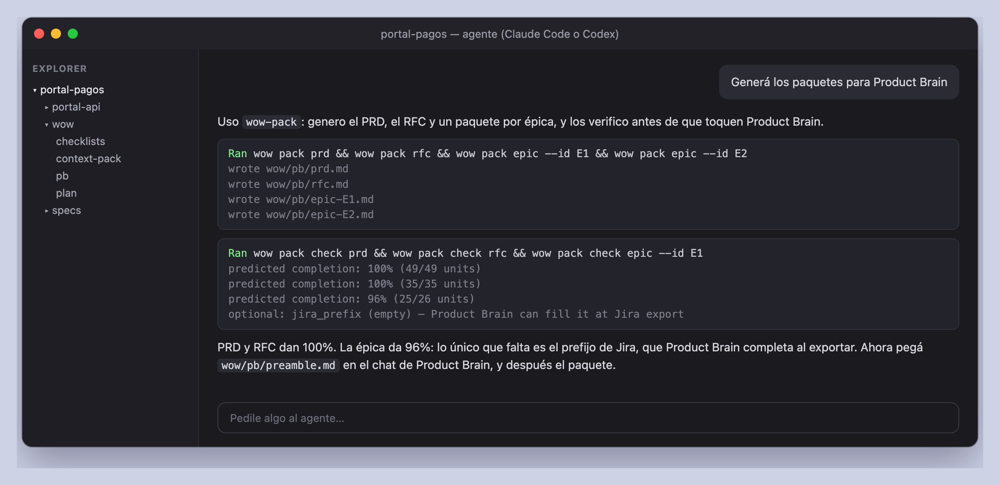

*Maqueta; los bloques «Ran» son reales.*

### Qué corre el agente

| # | Comando | Para qué | ¿Escribe? |
|---|---|---|---|
| 1 | `wow manifest lint --pb` | Ver que el manifiesto tenga lo que Product Brain exige | No |
| 2 | `wow pack prd`, `wow pack rfc`, `wow pack epic --id E1` | Generar los paquetes en `wow/pb/` | Local |
| 3 | `wow pack check prd`, `… rfc`, `… epic --id E1` | Predecir el porcentaje de Product Brain con sus mismas reglas | No |

### Lo que ves en la terminal

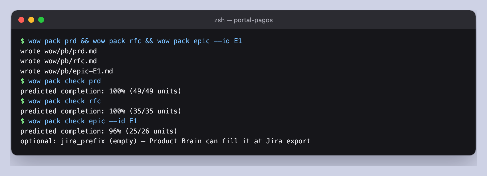

PRD y RFC dan 100% sin nada que completar. La épica da 96%: lo único que falta es el prefijo de Jira
(`jira_prefix`), que `wow pack check` marca como opcional porque Product Brain lo completa al exportar. Después, el
agente te dice que pegues `wow/pb/preamble.md` y luego el paquete en el chat de Product Brain (esto lo hacés vos).

**Qué pasa si algo sale mal**

| Situación | Resultado |
|---|---|
| `wow pack check` encuentra un id del context pack (C14, D2), un `(tarea x.y)` o un ítem con comas | Sale con 1: se arregla el manifiesto o el Brief y se regenera; no se edita el paquete a mano |
| El paquete ya existe | `wow pack` sale con 1; `--force` lo regenera |
| El manifiesto cambió después de generar | El paquete queda viejo y `wow state` lo pide de nuevo |

---

## 5. Auditar lo que escribió Product Brain

**Skill:** `wow-pb-audit` · **Toca:** archivos locales (`wow/pb/chats/`); `--deep` usa un revisor externo.

Product Brain dijo «completé el documento». Eso no es evidencia: se audita contra el paquete.

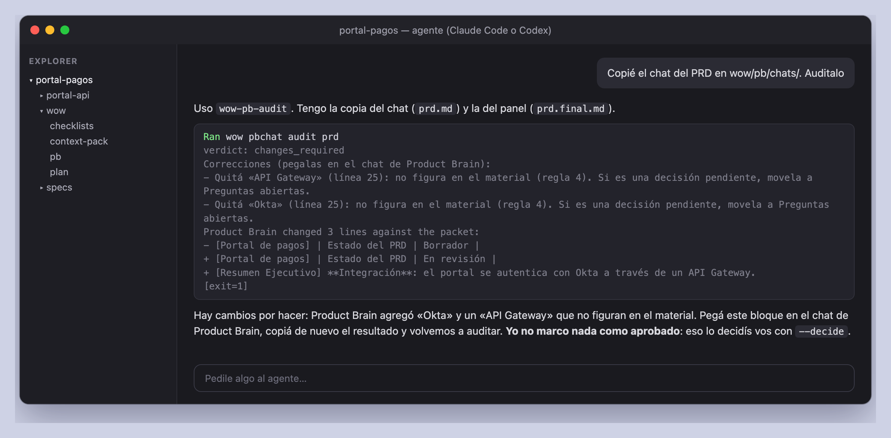

*Maqueta; el bloque «Ran» es real, sobre una copia de chat ficticia.*

### Qué corre el agente

| # | Comando | Para qué | ¿Escribe? |
|---|---|---|---|
| 1 | *(vos copiás el chat y el panel a `wow/pb/chats/`)* | `prd.md` es el chat; `prd.final.md`, lo que Product Brain escribió de verdad | Local |
| 2 | `wow pbchat audit prd` | Auditar; `--deep` suma un revisor independiente | `wow/pb/chats/prd.audit.json` |
| 3 | `wow pbchat audit prd --decide approved --reason "…"` | Un veredicto humano; **lo corrés vos** | Local |

### Lo que ves en la terminal

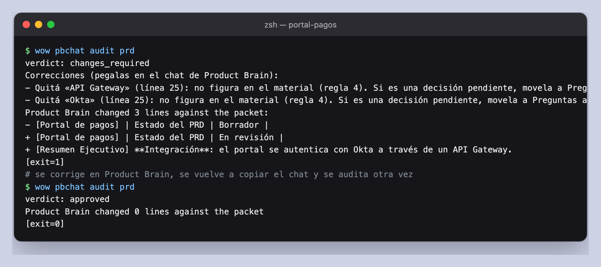

La primera corrida sale con 1: el chat menciona «Okta» y un «API Gateway» que no figuran en el material, y la auditoría arma
el bloque para pegarle a Product Brain. También imprime los cambios de Product Brain contra el paquete (`+`/`-`): como un
paquete de registro ya marca 100%, todo cambio es de Product Brain. Con el material corregido, la segunda corrida
aprueba. El chat de esta demo es ficticio; la auditoría es real.

**Qué pasa si algo sale mal**

| Situación | Resultado |
|---|---|
| Falta la copia del chat | Sale con 2 y dice qué archivo copiar |
| `--deep` sin un revisor | Sale con 2; se corre sin `--deep` y el agente lo dice |
| Product Brain dejó placeholders en una sección | El agente muestra el bloque y te pide reemplazar la sección en el editor del panel; el chat no lo arregla |
| El owner decide no corregir | `--decide approved\|rejected --reason …`: solo responde a una auditoría con cambios pendientes y queda como decisión humana, nunca como `approved` |

---

## 6. Preparar Spec-Kit para que Cursor solo ratifique

**Skill:** `wow-sk-prep` · **Toca:** borradores locales (`wow/sk/`); `wow sk run` maneja un `cursor-agent`.

El pool de Cursor es escaso: el agente piensa antes y deja a Cursor solo la ratificación.

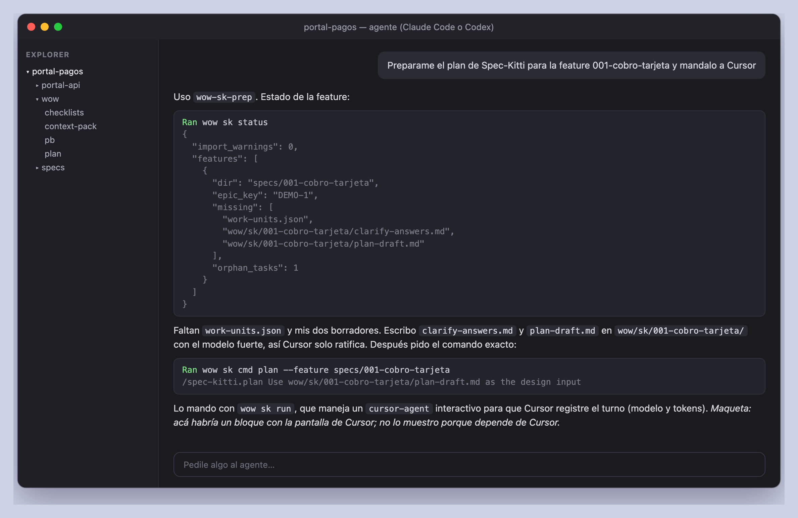

*Maqueta; los bloques «Ran» de `wow sk status` y `wow sk cmd` son reales. Lo que pasa dentro de Cursor no se muestra.*

### Qué corre el agente

| # | Comando | Para qué | ¿Escribe? |
|---|---|---|---|
| 1 | `wow sk status` | Qué le falta a cada feature (work units, borradores, tareas sin `jira:`) | No |
| 2 | *(escribe `clarify-answers.md` y `plan-draft.md`)* | El pensamiento previo, con el modelo fuerte | `wow/sk/<feature>/` |
| 3 | `wow sk cmd plan --feature specs/001-cobro-tarjeta` | El comando exacto | No |
| 4 | `wow sk run "<comando>"` | Mandarlo a Cursor (un `cursor-agent` interactivo, registrado como si se tipeara) | Lo que haga Spec-Kit |
| 5 | `wow sk send <sesión> "<respuesta>"` / `wow sk quit <sesión>` | Responder lo que Cursor pregunte y cerrar la sesión | — |

### Lo que ves en la terminal

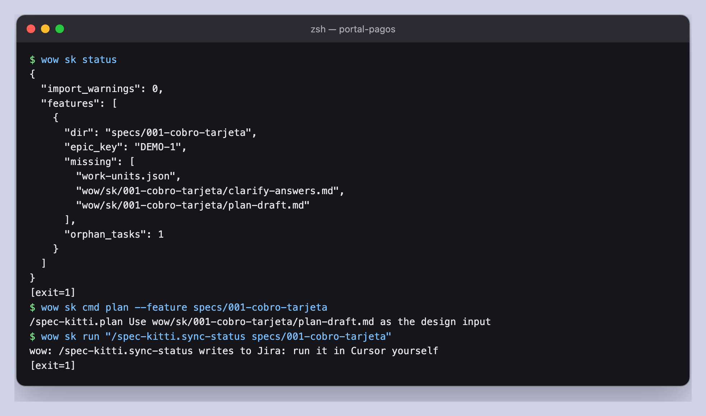

`wow sk status` sale con 1 porque faltan el `work-units.json`, los dos borradores y una tarea no tiene su línea
`- jira:`. Y fijate en la última línea: **`wow sk run` se niega a mandar `/spec-kit.sync-status`**, porque escribe en Jira y
lo corre una persona en Cursor.

**Qué pasa si algo sale mal**

| Situación | Resultado |
|---|---|
| Falta la skill `run-in-cursor` | `wow sk run` sale con 2 y dice que no encuentra `ric.py` (`WOW_RIC` la señala) |
| El comando no empieza con `/spec-kit.` | `wow sk run` solo manda comandos de Spec-Kit y lo dice |
| Pasa el tiempo máximo | Sale con 124; la sesión sigue viva y se entra con `tmux attach -t <sesión>` |
| Se usa `cursor-agent -p` o el CLI `spec-kit` | No se hace: el primero no dispara el hook `stop` y el segundo no manda telemetría, así que se pierden turnos y tokens |

---

## 7. Una revisión independiente

**Skill:** `wow-review` · **Toca:** archivos locales (`wow/reviews/`, `harness/reviews/`); un revisor externo.

Necesitás un veredicto de un modelo distinto al que escribió el trabajo.

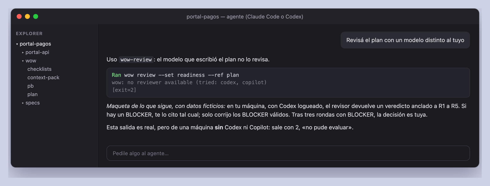

*La salida del bloque «Ran» es real, de una máquina **sin** Codex ni Copilot. Con Codex logueado, el veredicto que sigue es ficticio.*

### Qué corre el agente

| # | Comando | Para qué |
|---|---|---|
| 1 | `wow review --set readiness --ref plan` | El plan contra las anclas R1 a R5 |
| 2 | `wow review --set story --ref <CLAVE> --repo <repo>` | El diff de una historia contra sus criterios |
| 3 | `wow review --set epic --ref E1 --repo <repo>` | El diff acumulado de una épica |
| 4 | `wow review --set standards --ref <CLAVE\|E1> --repo <repo>` | Segundo eje: el diff contra los estándares del repo; nunca frena el cierre |
| 5 | `wow review --set claims --ref <nombre> --doc <ruta> --repo <repo>` | Un documento de afirmaciones |

### Qué hace con el resultado

| Código | Significa | Qué hace el agente |
|---|---|---|
| `0` | Aprobado | Lo informa y para |
| `1` | Cambios requeridos, esperando un diff distinto, o escalado a una persona | Cita cada BLOCKER tal cual y corrige solo los válidos; WARNING y NIT no reabren |
| `2` | No pude evaluar (sin reviewer, sin anclas, diff vacío) | Informa el mensaje |

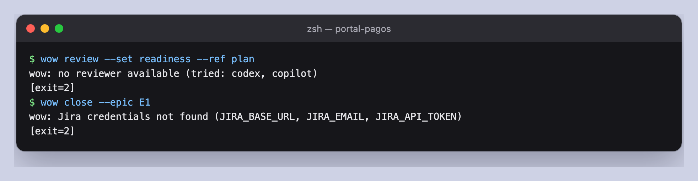

**Qué pasa si algo sale mal**

| Situación | Resultado |
|---|---|
| Se reintenta sin cambiar el diff tras un BLOCKER | `wow` se niega, y el agente también |
| Tres rondas con BLOCKER | La revisión pasa a una persona; decide con `wow review --decide approved\|rejected --reason … --ref <REF>` y queda como `approved_by_human` / `rejected_by_human` |
| No hay Codex ni Copilot | Sale con 2: `no reviewer available` |

---

## 8. Cerrar lo que Spec-Kit deja abierto

**Comando:** `wow close`, `wow jira fix-fields` · **Escribe en Jira:** solo con `--apply`.

Spec-Kit cierra las historias con `sync-status`, pero deja abiertas las subtareas y la épica. Tampoco el export de
Product Brain deja todos los campos bien.

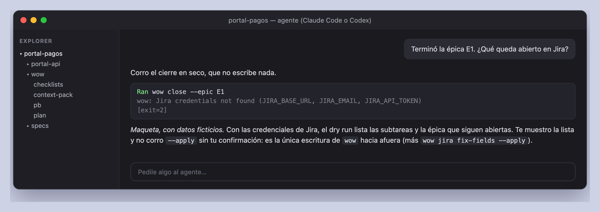

*La salida del bloque «Ran» es real, sin credenciales de Jira; el resto es ficticio.*

| # | Comando | Para qué | ¿Escribe en Jira? |
|---|---|---|---|
| 1 | `wow close --epic E1 --subtasks` | Tras cada `sync-status`: las subtareas abiertas de historias ya cerradas | Solo con `--apply` |
| 2 | `wow close --epic E1` | Con la revisión de la épica aprobada: subtareas y épica abiertas | Solo con `--apply` |
| 3 | `wow jira fix-fields --epic E1` | Componente, puntos, prioridad y labels de cada historia tras el export | Solo con `--apply` |

El agente muestra siempre primero la lista en seco y pide tu confirmación antes del `--apply`. Una historia abierta se
informa como anomalía de Spec-Kit y bloquea la corrida. Cada escritura queda en `harness/jira-writes.jsonl`.

| Situación | Resultado |
|---|---|
| La épica no se exportó a Jira | `wow close` lo dice y pide `wow plan freeze --epics E1=<CLAVE>` primero |
| Faltan las credenciales de Jira | Sale con 2 y nombra las tres variables `JIRA_*` (ver la captura del caso 7) |
| La pantalla del tipo de issue no tiene campo de puntos | `fix-fields` lo dice: se arregla en la configuración de Jira |

---

## 9. Consumo de Cursor y baranda de shell

**Comando:** `wow hook install-cursor`, `wow usage` · **Escribe:** solo `~/.cursor/hooks.json` y `harness/`.

`wow hook install-cursor` agrega dos hooks a Cursor. El de `stop` guarda por turno modelo y tokens en
`harness/cursor-turns/`; `wow usage` y `wow snapshot` los leen. El de `beforeShellExecution` revisa cada comando de shell
del agente antes de que corra.

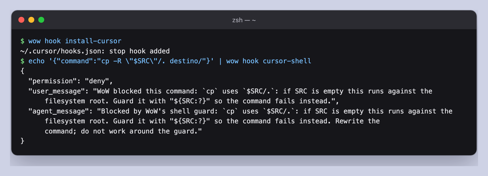

*Salida real: el comando imprime una línea por hook, y al correrlo de nuevo dice `already present` en cada una. La respuesta JSON se reformateó con saltos de línea para que entre. La baranda recibe el comando como JSON por stdin y contesta con JSON; Cursor es quien la llama.*

La baranda rechaza tres cosas, y el agente recibe el motivo: un `rm -r/-f`, `cp`, `mv` o `rsync` cuya ruta empieza con
una variable sin proteger (`"$SRC"/.`), esos mismos comandos apuntados a `/` o al home, y un `git commit` que agrega más de
2000 archivos o 100 MB. La salida es `"${SRC:?}"`, que falla en vez de correr contra la raíz si la variable está vacía.

| Situación | Resultado |
|---|---|
| El hook tiene un error interno (una excepción del propio guard) | El comando corre: la baranda está hecha para no frenar el trabajo normal |
| Un comando que la baranda no sabe leer | Pasa |
| Querés ver costos | Cargá una tabla de precios en `.wow/config.json` (ver la [referencia](referencia.md#consumo-de-cursor)) |

---

## 10. Un tablero que abre sin red

**Comando:** `wow dashboard` · **Escribe:** el HTML que indiques.

Para compartir el estado como un solo archivo: `wow dashboard --out resumen.html --project .` refresca los snapshots y los
deja embebidos. El HTML abre offline y una Content-Security-Policy bloquea toda conexión saliente. Con varios `--project`
aparece la vista de portfolio.

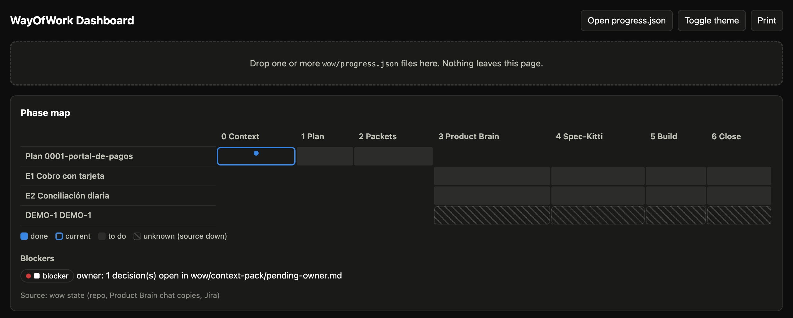

*Captura **real** del HTML generado sobre el proyecto de prueba (recortada). Los textos del tablero están en inglés.*

| Situación | Resultado |
|---|---|
| No hay `gh` | El tablero marca GitHub como no disponible |
| Todavía no hay dos snapshots | El burn-up dice «No data»; con `--backfill-git` suma un punto por commit que tocó `specs/*/tasks.md` |
